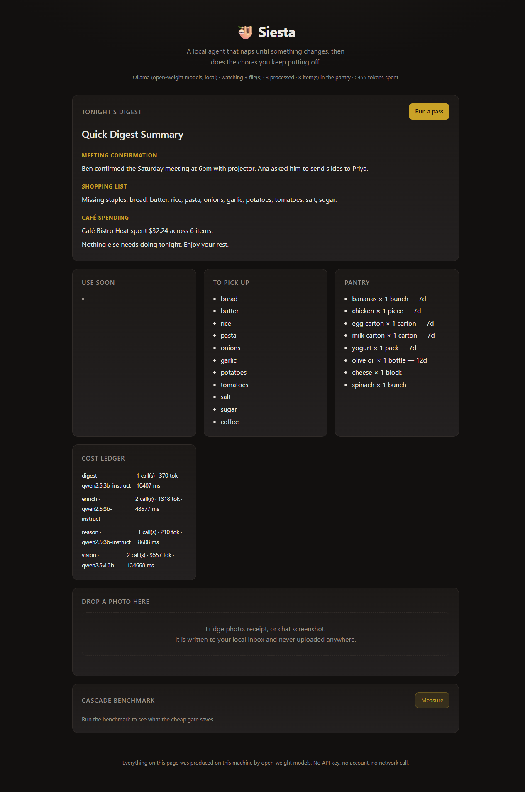
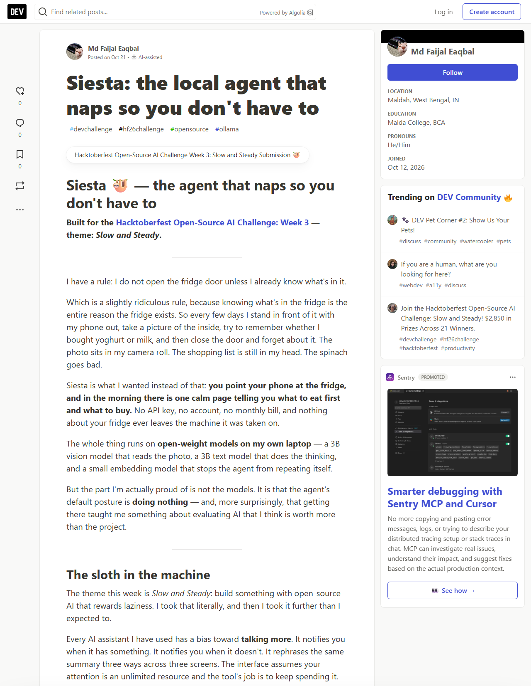
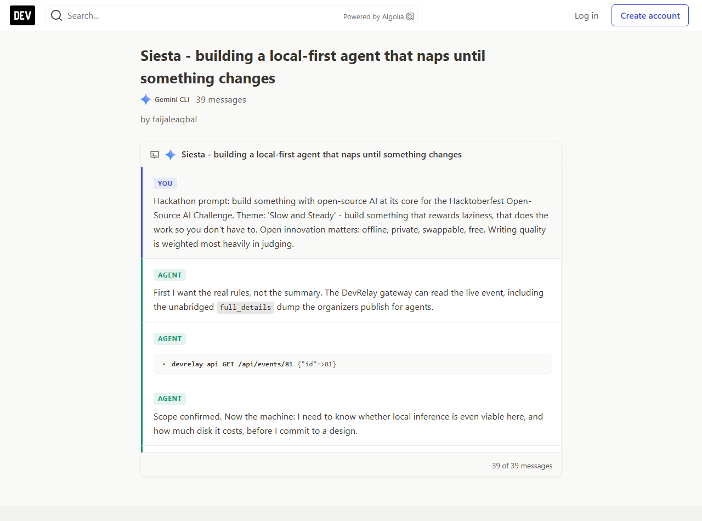
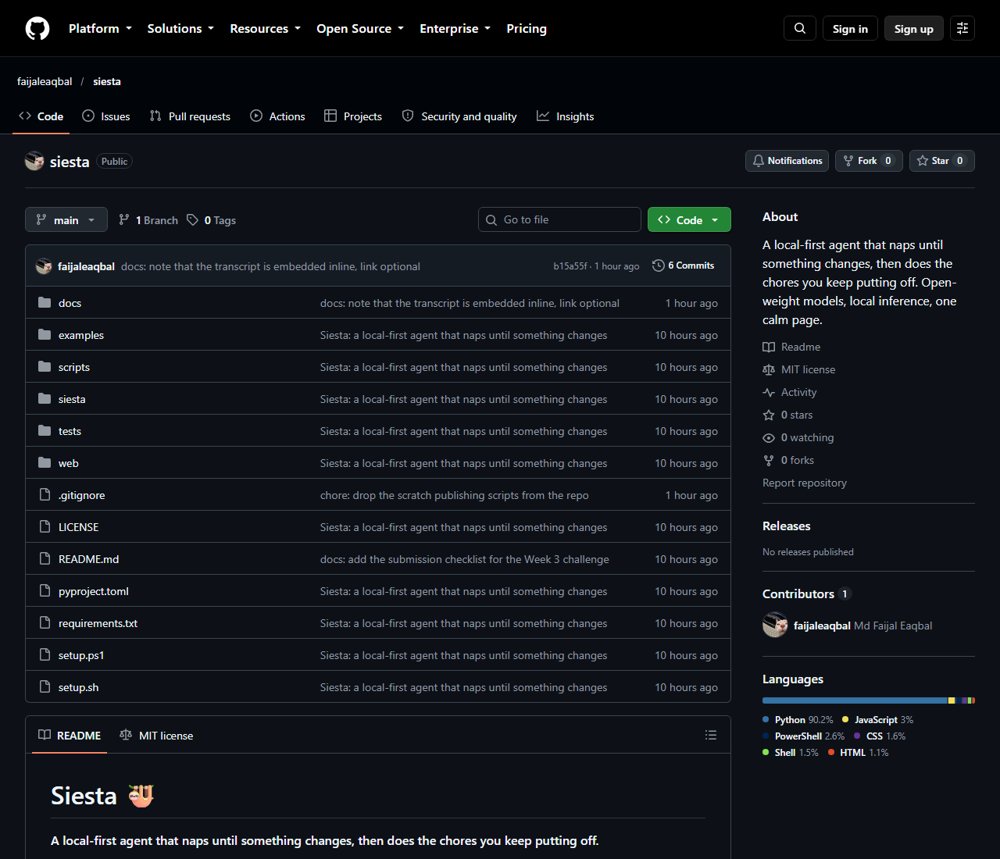

# Siesta 🦥

**A local-first agent that naps until something changes, then does the chores you keep putting off.**

You point your phone at the inside of your fridge. You drop a screenshot of a
group chat into a folder. In the morning there is one calm page waiting for
you — not forty notifications.

No API key. No account. No request ever leaves your machine. The models are
open-weight and they run on your own hardware, so it works on a laptop with
the Wi-Fi turned off and costs nothing per run.

```bash
python -m siesta scan
```



---

## The live thing, in pictures

| | |
|---|---|
| **The local web UI** — the digest, the pantry, and the cost ledger of every model call the agent has made |  |
| **The published post** on DEV, tagged `#hf26challenge` |  |
| **The saved agent session** — 39 messages of the actual build, published so the transcript is readable |  |
| **This repository** |  |

---

## The problem with every other "AI assistant"

Most AI helpers want your data. You photograph your fridge, and the image
goes to someone else's server, gets logged, and may be used to train
something. Most of them also charge per call, so the bill arrives with the
utility. And most of them are *chatty* — they interrupt you to say nothing.

Siesta takes the opposite position on all three counts:

| | Typical assistant | Siesta |
|---|---|---|
| **Your photos** | uploaded to a remote API | never leave the disk |
| **Cost** | per-token, forever | $0 — the weights are already on your machine |
| **Interruptions** | a push notification per event | one digest, and only when it is worth reading |
| **Offline** | needs a connection | works with the network unplugged |
| **Swap the model** | vendor's choice, their pricing | one flag: `--text-model llama3.2` |

---

## What it actually does

Siesta watches one folder. When something new lands there it works out what
it is, does the job, and writes a single digest.

| Chore | Input | Output |
|---|---|---|
| **Pantry** | a photo of your fridge | item inventory, what to use first, a shopping list of missing staples |
| **Receipt** | a photo of a receipt | a line-by-line expense row in a local SQLite ledger |
| **Chat** | a chat screenshot or an exported transcript | a two-line "what did I miss" summary |
| **Tidy** | a folder of loose downloads | a proposed sort, applied only when you ask |

A run of `siesta scan` on a fridge photo looks like this:

```
Handled 1 file(s): pantry
  routing:
    fridge-photo.jpg                   -> pantry   (0.93, metadata)
  chores:
    [ok ] pantry    Use soon: spinach, milk; 12 staples missing
  digest -> C:\Users\you\.siesta\digests\20261020-231358.md
  1421 tokens · 3840 ms of model time · 4102 ms wall clock · 1/1 routed without a model
```

---

## The Nap Cascade

This is the part that makes it a *sloth* rather than a busybody, and it is
the part worth reading the source for.

Naive pipeline: every file goes through the biggest model, every file gets
its own summary, and you get told about all of it.

Siesta does the opposite, in four stages, and **stops as early as it
confidently can**:

```
                     ┌─────────────────────────────────────────────┐
  new file arrives ──▶│ STAGE 0  HASH CHECK                         │
                     │  same bytes as last time?  → go back to sleep │
                     └───────────────┬─────────────────────────────┘
                                     │ changed
                     ┌───────────────▼─────────────────────────────┐
                     │ STAGE 1  METADATA GATE            free      │
                     │  "receipts/receipt.png" → receipt           │
                     │  confident?  → straight to the chore       │
                     └───────────────┬─────────────────────────────┘
                                     │ unsure
                     ┌───────────────▼─────────────────────────────┐
                     │ STAGE 2  CHEAP VISION GATE   tiny VLM       │
                     │  "is this a fridge or a receipt?"            │
                     │  confident?  → straight to the chore       │
                     └───────────────┬─────────────────────────────┘
                                     │ still unsure
                     ┌───────────────▼─────────────────────────────┐
                     │ STAGE 3  ESCALATE             big LLM       │
                     │  only now does the expensive model look?    │
                     └───────────────┬─────────────────────────────┘
                                     │
                     ┌───────────────▼─────────────────────────────┐
                     │ STAGE 4  ONE DIGEST          big LLM        │
                     │  a single page for the whole batch          │
                     └─────────────────────────────────────────────┘
```

Two properties fall out of this for free:

**It sleeps when there is nothing to say.** Stage 0 compares content hashes.
Touch a file, re-sort a folder, rename something — the bytes did not change,
so the agent stays asleep and spends zero tokens. That check is what makes
`siesta watch` safe to leave running overnight on a machine you also use
during the day.

**It does not say the same thing twice.** Before writing a digest, Siesta
embeds it with the open-weight embedding model and compares it to the last
digest it wrote. If the cosine similarity is above `0.965`, the news is not
new and no second page appears. Re-photographing the same fridge does not
produce a second shopping list.

The routing decision for every file is recorded, so you can always ask how
often the cheap gate carried the load. `siesta scan` prints it, the web UI
shows it, and `siesta bench` measures it against a naive baseline.

---

## Measured, on a laptop with no GPU

Everything below is from a real run on an AMD integrated-GPU machine — 12 CPU
cores, 15 GB RAM, no NVIDIA card — using `qwen2.5vl:3b`,
`qwen2.5:3b-instruct` and `nomic-embed-text` locally. The numbers come out
of Siesta's own cost ledger, not out of a guess.

**Two nights, three files (a fridge photo, a receipt, a chat transcript).**

| | model calls | tokens | pages for the user |
|---|---|---|---|
| **Night 1** — naive | 6 | 4,310 | 3 |
| **Night 1** — cascade | 5 | 5,182 | **1** |
| **Night 2** — naive (nothing changed) | 6 | 4,301 | 3 more of the same |
| **Night 2** — cascade (nothing changed) | **0** | **0** | **0** |
| **Two nights** — naive | 12 | 8,611 | 6 |
| **Two nights** — cascade | 5 | 5,182 | **1** |

39.8% fewer tokens over two nights, five model calls instead of twelve, and
**one page instead of six**. All three files were routed by the metadata gate,
so no model was ever asked *what* they were.

Read the night-1 row honestly: on the first night the cascade spends *more*
tokens than the naive pipeline (5,182 vs 4,310). That is the two-stage vision
design — a short, cheap scan plus a cheap text pass — and it buys structured,
verified output instead of a guess. The saving is not on night one. The saving
is that **night two costs nothing at all**, and every night after that.

A single pass over three files took 239 s wall clock and 5,721 tokens, of
which 106 s was model time.

**Accuracy**, against ground truth annotated by hand on the fridge photo:

| | |
|---|---|
| items actually in the photo | 8 |
| items the model reported | 8 (it listed the milk carton twice; the chore merges duplicates) |
| **precision** | **100%** — nothing was invented |
| **recall** | **100%** — nothing was missed |
| prompt tokens with the image | 1,587 (198 when the image was *not* arriving) |
| latency | ~21 s on CPU, 296 eval tokens |

Reproducible: three separate runs produced byte-identical output.

**The receipt** came out at $32.24 — the printed total, read correctly — with
six line items. The sum of the parsed line items did not match the printed
total, and the chore said so out loud rather than hiding it:

```
[ok ] receipt  Café Bistro Heat: 32.24 USD over 6 items
              (printed total 32.24 but the lines add up to 23.88)
```

---

## Two bugs worth reading about

### 1. The model was answering from the prompt, not the photo

Siesta's first "working" version scored **8 out of 8** on the fridge
benchmark. It was wrong. The model had never seen the image at all.

Ollama's `/api/chat` accepts a request-level `images` field — and silently
ignores it. The model then answers from the text of the prompt alone. The
telltale was that the prompt token count never moved: 198 tokens for a
fridge photo, when an attached image costs about 1,600.

The reason the bug was so convincing is that my prompt listed plausible
example items:

```
- name: what it is, lowercase and plain ("milk", "eggs", "cheddar cheese",
  "spinach", "chicken thighs", "yogurt", "bananas", "olive oil")
```

Those are exactly the items in the photo I was testing against — because I
had written the prompt *after* looking at the photo. The blind model
parroted my own instructions back at me, and it looked like a perfect
reading. A coincidence I had manufactured and then mistaken for a result.

The fix is two lines of code — put the images inside the message, where
Ollama reads them — but the real fix is that **Siesta now verifies the
picture arrived** on every single vision call:

```python
# an attached image costs roughly a thousand prompt tokens
response.saw_the_image()      # -> False means the model is answering blind
```

If the check fails, the vision chores fail loudly instead of quietly filling
your pantry with things that are not in it.

`siesta doctor` runs the same idea as a self-test: it sends a picture that is
red on top and green underneath, and asks the model what colours it sees.

```
vision      ok — Red and green.
```

### 2. The prompt had to be made neutral to measure anything

A benchmark where the prompt contains the answer measures the model's
ability to copy instructions. `scripts/accuracy_experiment.py` therefore
refuses to run if any ground-truth item name appears in the prompt, and
refuses to report a score if the image never arrived.

```bash
python scripts/accuracy_experiment.py
```

Both of these are the kind of bug that never shows up in a demo. They only
show up when you check the token counts and annotate the ground truth by
hand.

---

## Quickstart

### Windows

```powershell
powershell -ExecutionPolicy Bypass -File setup.ps1
```

### Linux / macOS

```bash
bash setup.sh
```

The setup script installs a portable Ollama runtime (no admin rights, no
system service), pulls the models, creates a virtualenv and writes your
config. It takes a few minutes mostly because of the downloads.

Then:

```bash
# drop a fridge photo into ~/Siesta-Inbox, then:
python -m siesta scan        # run one pass
python -m siesta serve       # local web UI on http://127.0.0.1:8765
python -m siesta watch       # the overnight loop
```

### Already have Ollama?

```bash
ollama pull qwen2.5vl:3b
ollama pull qwen2.5:3b-instruct
ollama pull nomic-embed-text
pip install -e ".[web]"
```

Siesta's core has **zero third-party runtime dependencies**. It talks to
Ollama over HTTP using the standard library, so `python -m siesta` works on a
bare Python 3.10+ install.

---

## The models

All three are open-weight and permissively licensed. Nothing here is a
fine-tuned proprietary model reached through a vendor API.

| Role | Model | Size | Licence |
|---|---|---|---|
| Vision (photos, receipts, screenshots) | `qwen2.5vl:3b` | ~3.0 GB | Apache-2.0 |
| Reasoning (planning, summaries, the digest) | `qwen2.5:3b-instruct` | ~1.8 GB | Apache-2.0 |
| Embeddings (name canonicalisation, duplicate detection) | `nomic-embed-text` | ~0.26 GB | Apache-2.0 |

Swapping any of them is a flag, not a code change:

```bash
python -m siesta scan --text-model llama3.2 --vision-model llava
python -m siesta scan --vision-model minicpm-v --embed-model bge-m3
```

If you prefer a bigger model on a bigger machine, nothing stops you —
`--text-model qwen2.5:7b` just works. That is the point of open weights.

**Structured output, not string parsing.** Every model call hands Ollama a
JSON Schema and lets the runtime constrain generation to match it. Small
models are enthusiastic but sloppy; constrained decoding means the pipeline
never has to regex a chat transcript to find a field.

---

## Why open-source AI was the right call here

This project exists because of a specific property that closed APIs do not
have: **the weights are on my disk, so the agent can be this conservative.**

1. **A closed API cannot afford to sleep.** Every call to a hosted model
   costs money and latency, so the rational design is to call as often as
   possible. With local weights the marginal cost of a call is a few seconds
   of CPU, so the rational design is to call *rarely* — hash first, gate
   first, escalate last. The cascade in this repo exists because the
   economics allow it.

2. **A closed API cannot be offline.** A weekend at a friend's place with bad
   wifi, a train, a plane, a server room with no egress. Siesta needs no
   socket to the outside world at all. The weights are local; the inference
   is local; the data never moves.

3. **A closed API cannot keep your data off someone else's server.** A fridge
   photo is a picture of your home. A chat screenshot is your private
   conversations. A receipt is your finances. None of them leave.

4. **A closed API cannot be changed.** The behaviour of a hosted model
   changes when the vendor ships a new checkpoint. With open weights, the
   model is a file I can swap, fine-tune, quantise, or run on a machine I
   control. If Qwen 3.5 turns out to read receipts better, I change one
   flag — I do not file a support ticket.

5. **A closed API cannot cost nothing.** Local inference is free forever.
   For a tool you leave running overnight, that is not a rounding error; it
   is the whole reason it is viable to build at all.

**Where open beat closed, concretely:** the cascade in this repo is only
*possible* because a local 3B vision model is cheap enough to be the
*second* model in the chain and still cheaper than one closed call. With a
hosted API, a "cheap first pass" is still a paid API call, and the
economics push you the other way — toward calling the expensive model for
everything.

---

## The privacy argument, concretely

Siesta never opens a socket except to `127.0.0.1:11434` (your own Ollama
server). The web UI binds to `127.0.0.1`. The database is a file in your
home directory. There is no telemetry, no analytics, no error reporting, no
crash upload. You can verify this:

```bash
# watch the network while Siesta works
python -m siesta scan
```

The only outbound traffic is the model download, once, at setup time.

---

## CLI reference

```
python -m siesta init            create folders and config
python -m siesta scan            run one pass now
python -m siesta status          what the agent has been up to
python -m siesta watch           the overnight loop (--interval minutes)
python -m siesta serve           local web UI (--host --port)
python -m siesta bench           measure what the cascade saves
python -m siesta doctor          check models, backend and folders
python -m siesta demo            run the whole pipeline on a generated sample
```

Useful flags: `--vision-model`, `--text-model`, `--embed-model`,
`--gate-model` (a cheap VLM used only for routing), `--apply-tidy` (move
files for real — it is a dry run by default), `--idle-seconds` (only wake
once you have been away that long), `--energy-aware` (stay quiet on battery).

---

## The nap policy

`siesta watch` runs on a timer, but two policies keep it out of your way:

- **Idle gate** — with `--idle-seconds 3600`, Siesta only wakes once you have
  been away from the keyboard for an hour. It reads the OS idle time
  (`GetLastInputInfo` on Windows, `System Events` on macOS).
- **Energy gate** — with `--energy-aware`, Siesta stays quiet while you are
  on battery. Local inference is free in money but not in watts.

Both are opt-in, because an assistant that never runs is not helpful.

---

## Project layout

```
siesta/
├── siesta/
│   ├── agent.py        the loop: discover → gate → chore → digest
│   ├── router.py       the cascade: metadata → cheap VLM → escalate
│   ├── chores/         pantry, receipt, chat, tidy
│   ├── backends/       ollama.py (real) and stub.py (deterministic)
│   ├── prompts.py      every prompt and JSON schema
│   ├── store.py        SQLite: items, digests, expenses, cost ledger
│   ├── energy.py       idle + battery detection
│   ├── nap.py          the watch loop
│   ├── bench.py        cascade vs naive
│   └── web.py          the local web UI
├── web/                a single-page UI, no build step, no CDN
├── tests/              52 tests, no model download required
└── setup.ps1 / setup.sh
```

The test suite runs against a **deterministic stub backend**, so
`pytest` works on a machine with no models and no network. The stub speaks
the same protocol and returns the same schemas — only the intelligence is
replaced. Every stub response is tagged `stub` in the cost ledger so it can
never be mistaken for real model output.

```bash
pip install -e ".[dev]"
pytest -q
```

---

## Licence

MIT. The models are Apache-2.0 (Qwen) and Apache-2.0 (nomic-embed-text).
Siesta is not affiliated with, endorsed by, or sponsored by any of them.

---

## Submitting this to a challenge

`docs/SUBMISSION.md` has the full checklist: where the staged DEV draft
lives, the saved agent session, the deadline, and the four things to do
before hitting publish.
