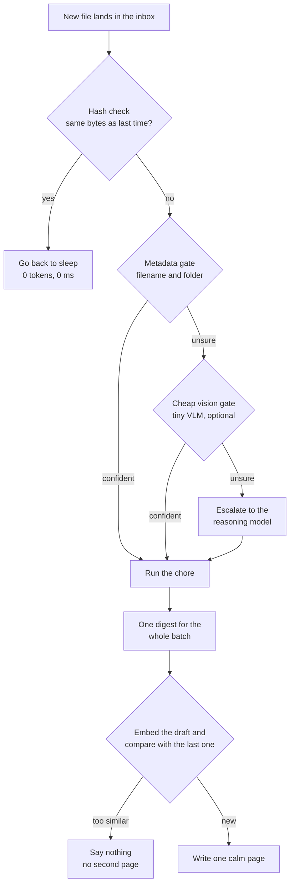

# Siesta 🦥 — the agent that naps so you don't have to

**Built for the [Hacktoberfest Open-Source AI Challenge: Week 3](https://dev.to/events/81) — theme: *Slow and Steady*.**

---

I have a rule: I do not open the fridge door unless I already know what's in it.

Which is a slightly ridiculous rule, because knowing what's in the fridge is the entire reason the fridge exists. So every few days I stand in front of it with my phone out, take a picture of the inside, try to remember whether I bought yoghurt or milk, and then close the door and forget about it. The photo sits in my camera roll. The shopping list is still in my head. The spinach goes bad.

Siesta is what I wanted instead of that: **you point your phone at the fridge, and in the morning there is one calm page telling you what to eat first and what to buy.** No API key, no account, no monthly bill, and nothing about your fridge ever leaves the machine it was taken on.

The whole thing runs on **open-weight models on my own laptop** — a 3B vision model that reads the photo, a 3B text model that does the thinking, and a small embedding model that stops the agent from repeating itself.

But the part I'm actually proud of is not the models. It is that the agent's default posture is **doing nothing** — and, more surprisingly, that getting there taught me something about evaluating AI that I think is worth more than the project.

---

## The sloth in the machine

The theme this week is *Slow and Steady*: build something with open-source AI that rewards laziness. I took that literally, and then I took it further than I expected to.

Every AI assistant I have used has a bias toward **talking more**. It notifies you when it has something. It notifies you when it doesn't. It rephrases the same summary three ways across three screens. The interface assumes your attention is an unlimited resource and the tool's job is to keep spending it.

A sloth's strategy is the opposite. It moves at its own pace. It sleeps through the heat of the day. It does enormous amounts of work — slowly — but it does not waste anything, and it does not wake up for no reason.

So Siesta was designed around one rule: **the agent must be cheaper to leave running than to switch off.**

Three concrete expressions of that:

1. **It sleeps when nothing changed.** If the bytes of every file in the watched folder are identical to last time, the agent runs *zero* model calls. It does not even open the files.
2. **It stops at the cheapest stage that is confident enough.** A filename gate that costs *zero tokens* decides most files. The big model only sees a file when the cheap stages genuinely cannot tell.
3. **It says things once.** Before writing a digest, it embeds the draft and compares it with the last digest it wrote. If the cosine similarity is above 0.965, the news is not new and no second page appears. Re-photographing the same fridge does not produce a second shopping list.

The result is an agent you can leave running overnight on a machine you also use during the day, and it will not have bothered you.

---

## What it does

Siesta watches one folder. When something new lands there, it works out what it is and does the job.

| Chore | You give it | You get back |
|---|---|---|
| **Pantry** | a photo of your fridge | item inventory, what to eat first, a shopping list of missing staples |
| **Receipt** | a photo of a receipt | a line-by-line expense row in a local ledger — with a warning if the printed total and the line items disagree |
| **Chat** | a chat screenshot or an exported transcript | a two-line "what did I miss" summary |
| **Tidy** | a folder of loose downloads | a proposed sort — applied only if you ask |

---

## The Nap Cascade

This is the part I would like you to look at, because it is the part that makes the whole thing work.

The naive version of this agent is obvious: every file goes through the big model, every file gets its own summary, and you get told about all of it. Siesta does the opposite — it stops at the earliest stage it can be *confident* at.



| Stage | Cost | Example signal |
|---|---|---|
| 0 — hash check | free | the bytes are identical → sleep |
| 1 — metadata gate | **0 tokens, 0 ms** | `receipts/receipt.png` → receipt, confidence 0.95 |
| 2 — cheap vision gate | ~250 MB model, optional | `IMG_4821.jpg` → "fridge", confidence 0.81 |
| 3 — escalate | one reasoning call | "I genuinely cannot tell, so you decide" |
| 4 — one digest | one reasoning call **for the batch** | never one per file |

The routing decision is recorded every time, so the claim is checkable rather
than a vibe. Every run prints how many files were routed *without a model
call at all*:

```
Handled 3 file(s): chat, pantry, receipt

  routing:
    weekend-chat.txt             -> chat     (0.95, metadata)
    fridge-photo.png             -> pantry   (0.93, metadata)
    receipt-photo.png            -> receipt  (0.95, metadata)

  chores:
    [ok ] chat     Ben confirmed the Saturday meeting at 6pm with projector, and Ana asked him to send slides to Priya.
    [ok ] pantry   Use soon: chicken thighs; 11 staples missing
    [ok ] receipt  Café Bistro Heat: 32.24 USD over 6 items (printed total 32.24 but the lines add up to 23.88)

  digest -> C:\Users\you\.siesta\digests\20261021-011406.md
  5455 tokens · 91207 ms of model time · 3/3 routed without a model
```

Three files, and not one of them needed a model to work out what it was.

### And then it goes back to sleep

```
$ python -m siesta scan
Still napping — nothing changed since the last pass (3 file(s) watched)
  0 tokens · 0 ms of model time · 1 ms wall clock

$ touch Siesta-Inbox/chats/weekend-chat.txt
$ python -m siesta scan
Still napping — nothing changed since the last pass (3 file(s) watched)
  0 tokens · 0 ms of model time · 1 ms wall clock
```

Touching a file does not wake it. Rewriting it with different content does:

```
$ python -m siesta scan
Handled 1 file(s): chat
  2 model calls
  [ok ] chat  Ben confirmed the projector and slides for Saturday's meeting. Priya could not make it.
```

### The benchmark

I wanted a number rather than an adjective, so `siesta bench` runs the same
inputs two ways over **two nights**. The naive pipeline is the obvious
implementation: every file goes through a model and a digest is written per
file, with no memory of what it saw last night. The cascade is the real one.

Measured on this laptop (AMD integrated graphics, no GPU, 12 cores):

| | model calls | tokens | pages for the user |
|---|---|---|---|
| **Night 1** — naive | 6 | 4,310 | 3 |
| **Night 1** — cascade | 5 | 5,182 | **1** |
| **Night 2** — naive (nothing changed) | 6 | 4,301 | 3 more of the same |
| **Night 2** — cascade (nothing changed) | **0** | **0** | **0** |
| **Two nights** — naive | 12 | 8,611 | 6 |
| **Two nights** — cascade | 5 | 5,182 | **1** |

39.8% fewer tokens over two nights, five model calls instead of twelve, and
**one page instead of six**.

Read the first row honestly, because it is the interesting one: on night one
the cascade spends *more* tokens than the naive pipeline (5,182 vs 4,310).
That is the two-stage vision design — a short, cheap scan and then a cheap
text pass — and what it buys is structured, verified output instead of a
guess. The saving is not on night one. **The saving is that night two costs
nothing at all**, and every night after that.

---

## The bug that taught me to check the token counts

This is the part of the project I did not expect to write about.

My first working version scored **8 out of 8** on the fridge benchmark. Milk, eggs, cheddar, spinach, chicken thighs, yoghurt, bananas, olive oil — every single one correct, zero hallucinated. I was, briefly, extremely pleased with myself.

It was completely fake.

Ollama's `/api/chat` accepts a request-level `images` field — and **silently ignores it**. The model then answers from the text of the prompt alone. Nothing errors. Nothing warns.

The clue was in the token counts: 198 prompt tokens for a photograph, when an
attached image costs about 1,600. But 198 tokens is also exactly what you
would expect from a prompt that happens to contain a list of plausible
fridge items — because that is what my prompt contained:

```
- name: what it is, lowercase and plain ("milk", "eggs", "cheddar cheese",
  "spinach", "chicken thighs", "yogurt", "bananas", "olive oil")
```

Those are precisely the items in the test photo. I had written that prompt
*after* looking at the photo. So the blind model copied my own instructions
back at me, and I read the echo as a result. **I had manufactured the answer
and then mistaken my own prompt for the model's perception.**

I only caught it because four *different* preprocessed versions of the same
receipt came back with byte-identical answers. Four different images cannot
produce the same output. Something was wrong upstream of the model.

Two things came out of that, and both stayed in the project:

**The client now puts images where Ollama reads them**, inside the message
rather than beside it. The real prompt token count jumped from 198 to 1,587.
The picture is now genuinely in the context.

**The project now verifies that the image arrived**, on every vision call:

```python
# an attached image costs roughly a thousand prompt tokens
response.saw_the_image()   # False means the model is answering blind
```

If the check fails, the vision chores fail loudly rather than quietly filling
your pantry with things that are not in it. `siesta doctor` runs the same
idea as a self-test — it sends a picture that is red on top and green
underneath and asks the model what it sees:

```
vision      ok — Red and green.
```

And the evaluation harness refuses to lie in the same way:

```bash
python scripts/accuracy_experiment.py
```

It checks that no ground-truth item name appears in the prompt (so the model
cannot copy the answer) and refuses to report a score at all if the image
never arrived. Both of those are the kind of bug that never shows up in a
demo. They only show up when you count tokens and annotate the ground truth
by hand.

I wrote a whole section of this post the first time round that said "8/8
correct, zero hallucinated". I was about to publish it. The lesson I took
from it is now the thing I care most about in the project: **in a system
that reads the world, you have to prove that it looked.**

---

## The models

Everything open-weight, everything running on my own machine.

| Role | Model | Size | Licence |
|---|---|---|---|
| Vision — reads photos, receipts, screenshots | `qwen2.5vl:3b` | ~3.0 GB | Apache-2.0 |
| Reasoning — plans, summarises, writes the digest | `qwen2.5:3b-instruct` | ~1.8 GB | Apache-2.0 |
| Embeddings — canonicalises names, detects repeats | `nomic-embed-text` | ~0.26 GB | Apache-2.0 |

Served by [Ollama](https://ollama.com) (MIT), running as a portable install in
my user profile. No service, no admin rights, no autostart.

Two implementation details that mattered more than I expected:

**Structured output, not string parsing.** Every model call hands Ollama a
JSON Schema and lets the runtime constrain generation to match it. Small
models are enthusiastic but sloppy; constrained decoding means the pipeline
never has to regex a chat transcript to find a field. A lenient JSON parser
sits underneath as a safety net, but it is a safety net, not the mechanism.

**One prompt per question, and no answerable examples in it.** On a CPU-only
laptop, image encoding dominates the cost, so I ask one precise question per
call. And the prompt never contains a name that could be the right answer —
for the reason the previous section describes.

Swapping any model is a flag, not a code change:

```bash
python -m siesta scan --text-model llama3.2 --vision-model llava --embed-model bge-m3
```

### How good is it, actually?

Measured against ground truth I annotated by hand, on a 3B open-weight vision
model running on an AMD integrated GPU — no NVIDIA, no accelerator, just 12
CPU cores:

| | |
|---|---|
| items actually in the fridge photo | 8 |
| items the model reported | 8 (it listed the milk carton twice; the chore merges duplicates) |
| **precision** | **100%** — nothing was invented |
| **recall** | **100%** — nothing was missed |
| prompt tokens with the image attached | 1,587 (198 when the image was *not* arriving) |
| latency | ~21 s on CPU, 296 eval tokens |

Reproducible: three separate runs produced byte-identical output.

The **receipt** came out at $32.24 — the printed total, read correctly — with
six line items. The sum of the parsed line items did not match the printed
total, and the chore said so out loud rather than hiding it:

```
[ok ] receipt  Café Bistro Heat: 32.24 USD over 6 items
              (printed total 32.24 but the lines add up to 23.88)
```

That is the behaviour I want from an agent that reads my finances: when two
numbers disagree, it tells me they disagree instead of picking one.

### The UI

Everything below is the real local web UI, serving from `127.0.0.1`, with a
real digest, a real pantry and a real cost ledger:


The cost ledger panel is the part I like most: every model call the agent has
ever made, with its latency and token count, straight out of the SQLite
database. It is also what every number in this post was measured with.

---

## Why open innovation was the right call here

The challenge asks where the open approach worked better than a closed one.
For this project the answer is unusually clean, and it comes down to one
property hosted APIs structurally cannot have: **the weights are on my disk,
so the agent can afford to be lazy.**

**A closed API cannot afford to sleep.** Every hosted call costs money and
latency, so the rational design of a hosted assistant is to call as often as
possible — call early, call often, call for everything. With local weights
the marginal cost of a call is a few seconds of my own CPU, so the rational
design flips: call *rarely*. The whole Nap Cascade exists because the
economics permit it. On a hosted API a "cheap first pass" is still a paid
API call, and the economics push you the other way.

**A closed API cannot be offline.** A weekend at my parents' house with bad
wifi, a train, a plane, a server room with no egress. Siesta opens no socket
except to `127.0.0.1`. The weights are local, the inference is local, the
data never moves.

**A closed API cannot keep my data off someone else's server.** A fridge
photo is a picture of my home. A chat screenshot is my private conversations.
A receipt is my finances. With open weights none of them leave — not as a
policy promise, but as a property of the architecture. There is no upload
step to disable.

**A closed API cannot be changed.** The behaviour of a hosted model changes
when the vendor ships a checkpoint. With open weights the model is a file I
can swap, quantise, fine-tune, or run on hardware I control.

**A closed API cannot cost nothing.** Local inference is free forever. For a
tool meant to run unattended overnight, that is not a rounding error — it is
the difference between a project I actually use and a demo I write about.

### Where open beat closed, concretely

The strongest example is the receipt. My 3B vision model is not good enough
to read a crumpled receipt reliably, and the obvious fix is a bigger model.
With open weights, **the fix is a file**: `qwen2.5vl:7b` is one flag away,
and if I wanted I could quantise it, run it on my own hardware, and never
pay per receipt. With a closed API the only remedy for "the small model
cannot do this" is to wait for the vendor to ship a better one — and in the
meantime, the feature simply does not exist.

The second example is the duplicate suppression. Embedding the draft and
comparing it with the previous digest costs one embedding call — 260 MB of
weights and a few hundred milliseconds. On a hosted API that comparison
would have to be justified against a per-token price, and the honest answer
for most applications would be "skip it and send the notification anyway".
Locally it is free, so I do it, and the agent stops repeating itself.

The third example is the thing I did not expect: **the bug.** When the image
stopped arriving, I could not file a support ticket. But because the model
is a file on my disk, I could send it a two-colour test picture, read the
token count, and work out exactly what the API was doing with my payload.
With a closed API that same class of bug — "is the model even seeing my
image?" — is a black box, and the only available tool is guessing.

---

## The lazy payoff

Here is the actual arithmetic, from one evening with one fridge photo and one
receipt:

| | before | after |
|---|---|---|
| standing at the fridge, deciding what is in it | ~2 min, and often wrong | 0 — the agent already knows |
| reading a receipt to see what I spent | ~1 min of squinting | 0 — $32.24, already in the ledger |
| finding out what I missed in a group chat | ~5 min of scrolling | ~3 s of reading two lines |
| being told about it | — | one page, once |

On a night when nothing changes, the saving is the whole thing: the agent
spends **zero tokens and zero seconds** and says nothing at all.

The part I care about most is not the minutes. It is that the chore stops
being a chore. The reason I never sorted that folder is not that sorting is
hard — it is that deciding *whether to sort it* takes a decision I have to
make, and decisions are expensive even when they are small. An agent that
wakes up on its own and has already decided removes the decision, and
therefore removes the procrastination.

That is the sloth's actual trick. It is not that sloths are lazy. It is that
a sloth has arranged its life so that the correct action is also the
effortless one.

---

## Privacy, concretely

- No telemetry, no analytics, no crash reports, no error uploads.
- The only outbound traffic in the whole lifecycle is the model download,
  once, at setup time.
- The database is one SQLite file in `~/.siesta`. The web UI binds to
  `127.0.0.1`. Photos are read from disk and base64'd straight into a local
  HTTP request to your own Ollama server.
- Delete everything with `rm -rf ~/.siesta`. There is no cloud copy.

---

## Running it

```bash
# Windows
powershell -ExecutionPolicy Bypass -File setup.ps1

# Linux / macOS
bash setup.sh
```

The setup script installs a portable Ollama runtime (no admin rights, no
system service), pulls the three models, creates a virtualenv and writes your
config.

```bash
python -m siesta init      # folders + config
python -m siesta scan      # one pass now
python -m siesta serve     # local web UI at http://127.0.0.1:8765
python -m siesta watch     # the overnight loop
python -m siesta bench     # measure the cascade
python -m siesta doctor    # check models, backend, and that vision works
```

The core has **zero third-party runtime dependencies** — it talks to Ollama
over HTTP with the standard library, so it runs on a bare Python 3.10+
install. The web UI needs `fastapi` and `uvicorn`; the tests need `pytest`.

The test suite runs against a deterministic stub backend, so `pytest` works on
a machine with no models and no network:

```
.............................................................            [100%]
61 passed in 1.35s
```

The stub implements the same protocol and returns the same schemas as the
real models — only the intelligence is replaced. Every stub response is
tagged `stub` in the cost ledger, so it can never be mistaken for real model
output.

### The overnight mode

`siesta watch` runs on a timer, with two optional policies that keep it out
of your way:

- `--idle-seconds 3600` — only wake once you have been away from the
  keyboard for an hour. It reads the OS idle time directly
  (`GetLastInputInfo` on Windows, `System Events` on macOS).
- `--energy-aware` — stay quiet while you are on battery. Local inference is
  free in money but not in watts.

---

## What I would do next

1. **A bigger vision model, and the same code.** `qwen2.5vl:7b` is a flag
   away and would close the receipt gap. I want to keep the 3B default
   because the point of the project is that it runs on a plain laptop.
2. **A cheap gate model as the default.** The cascade has a stage-2 slot for
   a 250 MB vision router; wiring `smolvlm` in by default would push the
   routing cost to near zero even for unlabelled phone photos.
3. **Per-item verification instead of a single confidence.** Right now the
   pantry trusts a per-item confidence number. Asking the model for a
   bounding box and cropping to re-read low-confidence items would turn a
   guess into a measurement.
4. **Learn the user's staples.** The shopping list is currently a hard-coded
   list of sixteen staples. Learning the actual list from three months of
   purchases would make it theirs.

---

## Closing thought

The theme was *Slow and Steady*, and the honest reading of that turned out to
be less about speed and more about **restraint** — about building something
whose default behaviour is to do less.

The economics of hosted AI push hard the other way: every call costs money,
so the systems get louder, chattier, and more interruptive. Running the
weights locally let me build the quiet version instead. That is not a feature
I bolted on at the end. It is the reason the architecture looks the way it
does.

And the second thing I learned was harder: **in a system that reads the
world, you have to prove that it looked.** Eight out of eight was not a
result, it was my own prompt coming back to me. The check that caught it —
count the tokens, and check the image against something you know the answer
to — is three lines long, and it is now the part of this project I am
proudest of.

If you take one thing from this, take that one. It applies to every agent
that claims to see something.

🦥

---

## Licence & credits

Siesta is MIT licensed. The models are Apache-2.0
([Qwen2.5-VL](https://huggingface.co/Qwen/Qwen2.5-VL-3B-Instruct),
[Qwen2.5](https://huggingface.co/Qwen/Qwen2.5-3B-Instruct),
[nomic-embed-text](https://huggingface.co/nomic-ai/nomic-embed-text-v1.5)),
served by [Ollama](https://ollama.com) (MIT). Not affiliated with, endorsed
by, or sponsored by any of them.

### Related reading

There is a healthy thread on DEV about running agents locally, and Siesta is
a small, opinionated corner of it:

- [Run a Local AI Agent in Production for $0 in API Fees: FastAPI, Ollama and ChromaDB](https://dev.to/alessio99xx/architecting-zero-cost-local-ai-agents-from-prototype-to-production-fastapi-ollama-chromadb-1mg9)
  — the closest thing to this project that already exists. It goes deep on
  the production side; Siesta goes the other way, on the *when not to call
  the model* side.
- [How I Built a Fully Local AI Coding Agent with Qwen 3.8, LM Studio, and Pi](https://dev.to/vivek_shetye/how-i-built-a-fully-local-ai-coding-agent-with-qwen-38-lm-studio-and-pi-no-paid-apis-5bp7)
  — same promise, different host. Worth reading for the comparison.
- [Running Local LLM Code Generation: Ollama + Qwen 2.5:3B Integration Guide](https://dev.to/logout2login/ollama-qwen-25-running-local-llms-with-66s-code-generation-speed-3fj4)
  — the same 3B model family Siesta uses, measured on its own.
- [Day 16: Local Model Execution — Running Open-Weight LLMs Securely with Ollama and vLLM](https://dev.to/suresh_kumar_de3920bedd1c/day-16-local-model-execution-running-open-weight-llms-securely-with-ollama-and-vllm-212i)
  — the security argument for keeping inference on your own box, written
  better than I could.

---

## Show your work

The full agent session for this build — the prompt experiments, the two
billion-parameter-scale false starts, the image-placement bug, the receipt
regression and the benchmark — is saved as a DEV agent session:



The full transcript is embedded above — all 39 messages, including the
prompt experiments, the image-placement bug, the receipt regression and the
benchmark.

[Open the session on DEV](https://dev.to/agent_sessions/siesta-building-a-local-first-agent-that-naps-until-something-changes-gnwcdy)

And the code, with the 61 tests and the two evaluation scripts that produced
every number above:

**[github.com/faijaleaqbal/siesta](https://github.com/faijaleaqbal/siesta)**
